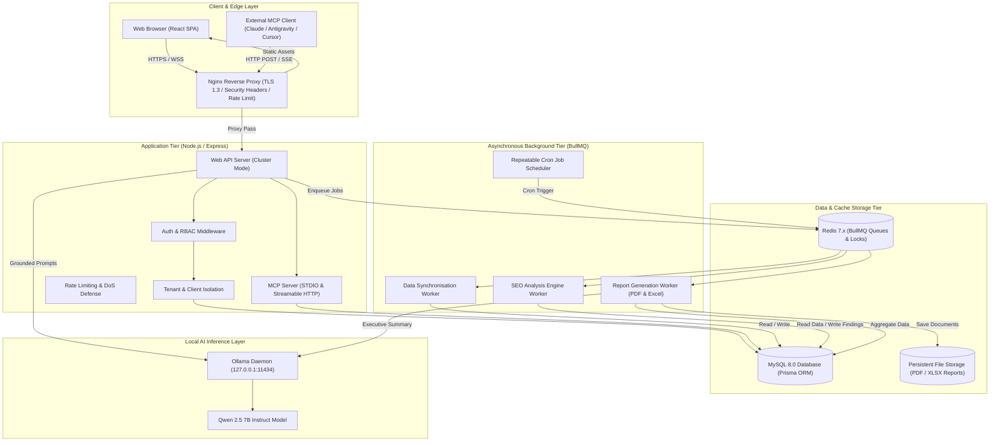
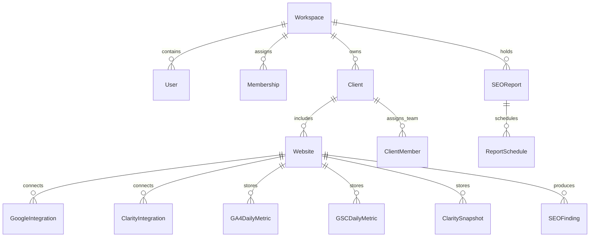

# System Architecture Specification
## Missive Digital SEO Intelligence Platform

**Document Version:** 1.0.0  
**Status:** Approved Architecture  
**Stack:** React 18, Node.js 20+, MySQL 8.0, Redis 7, BullMQ, Ollama (Qwen), Model Context Protocol (MCP)  

---

## 1. High-Level Architectural Diagram



---

## 2. Frontend Architecture

The frontend is built using **React 18** and **Vite** with **Tailwind CSS** and **Redux Toolkit**:

```
frontend/src/
├── app/               # Redux Store configuration and root reducer
├── features/          # Domain-driven slices and RTK Query API endpoints
│   ├── api/           # baseApi.js (central RTK Query with tag invalidation)
│   ├── auth/          # Authentication slice, tokens, user state
│   ├── clients/       # Client management API endpoints
│   ├── websites/      # Website entity API endpoints
│   ├── analytics/     # GA4, GSC, Clarity dashboards API
│   ├── seo-analysis/  # SEO engine findings API
│   ├── ai/            # Local AI consultation API & streaming handlers
│   ├── reports/       # Report generation, schedules, and branding API
│   └── mcp/           # MCP server admin and token management API
├── pages/             # Page route components
├── components/        # Reusable UI library (Modal, Table, Badge, Card)
└── router/            # React Router 7 route definitions & RBAC guards
```

### Key Architectural Characteristics
- **Dynamic API Base URL:** Configurable via `VITE_API_BASE_URL` with relative `/api/v1` fallback for single-origin reverse proxies.
- **Role-Based Navigation:** Navigation items and buttons conditionally render based on verified user permissions from the active workspace context.
- **Client-Side Token Handling:** Access tokens stored in-memory (Redux state); Refresh tokens stored strictly in HTTP-only, SameSite cookies.

---

## 3. Backend Architecture

The backend is organized as a **modular monolith** in Node.js using ES Modules (`"type": "module"`):

```
backend/src/
├── config/            # Database (Prisma), Redis, Environment, Logging
├── middleware/        # Authentication, RBAC, Tenant Isolation, Rate Limiters, Error Handling
├── modules/
│   ├── auth/          # Registration, Login, Argon2id, Refresh Token Rotation
│   ├── workspaces/    # Multi-tenant workspace management
│   ├── members/       # Team members, role assignments, invitations
│   ├── clients/       # Agency client management
│   ├── websites/      # Monitored website configuration
│   ├── integrations/  # GA4, GSC, Clarity credential encryption & imports
│   ├── analytics/     # Aggregated analytics retrieval & comparisons
│   ├── sync/          # Background data synchronisation controllers
│   ├── seo-analysis/  # Deterministic analysis engine & opportunity detection
│   ├── ai/            # Grounded local AI assistant & prompt guardrails
│   ├── reports/       # PDF/Excel report generators, schedulers & branding
│   └── health/        # Liveness & detailed readiness probes
├── queues/            # BullMQ connection & sync queue producers
├── workers/           # BullMQ sync worker & standalone worker entrypoint
├── mcp/               # Model Context Protocol tools, resources, prompts & transports
└── utils/             # AES-256-GCM encryption, date arithmetic, logger
```

---

## 4. Multi-Tenant Database Architecture

Multi-tenancy is enforced using a hybrid model:
1. **Workspaces (Tenants):** Top-level boundary. Every user, client, website, analytics snapshot, finding, and report is strictly scoped to a `workspaceId`.
2. **Client Scoping:** Within a workspace, non-admin users (SEO Managers, Executives, Viewers) are scoped strictly to assigned clients via the `ClientMember` table.
3. **Foreign Resource Masking:** Queries for resources outside a user's authorized scope return `404 Not Found` or `403 Forbidden`, eliminating enumeration risks.



---

## 5. Asynchronous Processing & Queue Architecture

All long-running tasks operate asynchronously on **BullMQ** and **Redis**:

| Queue Name | Producer | Consumer | Concurrency | Retry Policy | Purpose |
| :--- | :--- | :--- | :---: | :--- | :--- |
| `missive-seo-sync` | `sync.queue.js` | `sync.worker.js` | 3 | 3 attempts, exponential backoff (5s base) | Ingests GA4, GSC, and Clarity data |
| `missive-seo-analysis` | `seo-analysis.queue.js` | `seo-analysis.worker.js` | 2 | 2 attempts, 5s delay | Runs deterministic SEO analysis |
| `missive-seo-reports` | `report.queue.js` | `report.worker.js` | 2 | 3 attempts, 10s delay | Renders PDF and Excel audit reports |

- **Distributed Locking:** `SyncLockService` prevents concurrent overlapping synchronizations on the same website and provider.
- **Repeatable Jobs:** BullMQ native repeatable cron schedules trigger automated daily and weekly tasks without in-memory cron drift.

---

## 6. Local AI Assistant Architecture

The AI subsystem operates under a strict **Zero Cloud Egress** architecture:

```
[ User Prompt ]
       │
       ▼
[ AI Guardrail Sanitizer ] ──(Triggered)──> [ 400 Rejected: Jailbreak / Override ]
       │ (Clean)
       ▼
[ Context Retrieval Engine ] ──> Query MySQL (GA4, GSC, Findings, Baseline)
       │
       ▼
[ Grounded System Prompt Assembly ] (Strict instructions: use ONLY provided data)
       │
       ▼
[ Local Ollama Daemon (127.0.0.1:11434) ]
       │
       ▼
[ Qwen 2.5 7B Instruct Model ] ──> Stream response chunks to Client via SSE
```

- **No Remote AI Providers:** No OpenAI, Anthropic, or Gemini APIs.
- **Graceful Fallback:** If Ollama is offline or unconfigured, the application continues to operate seamlessly, falling back to deterministic summaries.

---

## 7. Model Context Protocol (MCP) Architecture

Built on the official `@modelcontextprotocol/sdk` for JavaScript:
- **Transports:**
  1. `STDIO Transport`: For local desktop clients (Claude Desktop, Antigravity, Cursor).
  2. `Streamable HTTP Transport`: Mounted at `/api/v1/mcp` for remote networked agents.
- **Capabilities Exposed:**
  - **20 Tools** across 6 domains (GA4 analytics, GSC queries, Clarity UX, deterministic SEO analysis, keyword opportunities, website performance).
  - **3 Resources** providing dynamic URI-addressable analytics context (`seo://websites/{id}/overview`, `seo://websites/{id}/analytics`, `seo://websites/{id}/findings`).
  - **3 Prompts** guiding external AI agents through structured SEO audits.
- **Security:** Authenticated via bearer tokens (`mcp_live_...`) with full audit logging in the `MCPAuditLog` database table.
